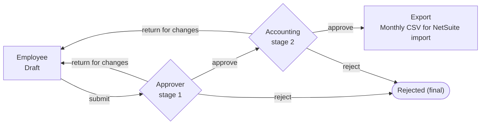

# Raporla

**Expense entry and approval for a small nonprofit, with a clean hand-off to NetSuite.**

Raporla replaces a process built on shared folders and typed signatures with one place where an employee files an expense, two people approve it, every decision is recorded for good, and the accountant gets a file NetSuite can import instead of retyping every line.

It is in pilot with a Turkish education nonprofit of about 20 people. The interface is in Turkish; this document is in English.

> The source code is private because it belongs to the organization. This repository is a case study: what the product does, why it is built the way it is, and what comes next.

---

## The problem

Before Raporla:

- Every employee kept a spreadsheet form and scanned receipts in their own Google Drive folder.
- "Approval" meant typing your name at the bottom of the spreadsheet.
- At month end the director opened 18 folders one by one to see what had been spent.
- The accountant typed every expense into NetSuite by hand, up to 70–100 lines per person in a busy month.

That produced three problems the whole project is built around:

1. **Data entry errors**: wrong project, wrong amount, a receipt that doesn't match.
2. **No trail of approvals**: no record of who approved what, when, or what it looked like at the time.
3. **Manual transfer into NetSuite**: the same data typed twice, by the person with the least time.

## How it works

A return from accounting goes through stage 1 again.

- **The unit is a single expense**, not a monthly report. Reports only appear at export time, grouped by employee and month, because that is how NetSuite structures an expense report: one header plus line items.
- **The employee picks their approver.** Project coordinators change often, so approval is not hard-wired to projects.
- **Three decisions at each stage:** approve, return for changes (a reason from a list plus a required comment), or reject (a final status with a reason from a list).
- **Accounting has its own checkbox for "paper original received".** Originals travel by courier and have gone missing before, so the checkbox is separate from the decision and saves as soon as it is ticked.

---

## What is built

### Entering an expense
- **Mobile-first form**, because employees file expenses from their phones, often with the receipt in hand. Drafts can be saved half-filled, and every field becomes required only once the expense leaves draft. A database constraint enforces that, not just the form.
- **Receipt photos are compressed on the phone** to about 300 KB before upload. Over a year that is roughly 15,000 photos at 3–5 MB each, which would eat both storage and employees' mobile data.
- **Files upload straight to private storage**, bypassing the server's request size limit. The app serves each receipt only to the people allowed to see it: the author, the assigned approver, accounting, the director and admins.
- **Duplicate warning** when the same vendor, document number and amount already exist. It is a warning, not a block, because two identical receipts can be legitimate.

### Approval and history
- **Append-only history.** Every action is a new row in an event table, and the database itself refuses any `UPDATE` or `DELETE` on it. The triggers are statement-level, so even an update that matches zero rows is rejected.
- **Separation of duties at the database level:** a person cannot approve their own expense.
- **A return from accounting goes back through the first stage.** While fixing one thing, the employee may change the project or the amount, and the first approval covered the old values. One extra step is cheaper than an approval that has quietly gone stale.
- **An expense can be withdrawn** back to draft until anyone has made a decision on it.
- **Name snapshots at submission.** If a project is renamed six months later, an approved expense still shows the name the approver saw.
- **Expense numbers** (`EXP-2026-0001`) are issued at submission, never change, and count up within the year of the *expense date*. A December expense filed in January stays in December's series, matching how NetSuite groups it. The counter increments inside the submit transaction, so two simultaneous submissions can't get the same number.

### Export to NetSuite (CSV)
- **One file per calendar month.** Each employee's lines share a stable external ID per month, so re-importing the same file updates the records instead of duplicating them. The server enforces whole months, since half a month under the same external ID could overwrite the other half.
- **Pre-flight check:** before generating the file, the app lists every project, category and department value that has no NetSuite mapping yet. One typo rejects an employee's whole monthly report in NetSuite, not just one line.
- **Generating a file is not the same as importing it.** An export run moves through `Created → Downloaded → Loaded / Failed`. If the import fails, the whole run rolls back and its expenses come back for the next export instead of silently dropping out.
- **Formatting traps handled:** `DD/MM/YYYY` dates, a decimal point despite the Turkish locale's comma, and UTF-8 so Turkish letters survive.
- **Trial import without approvals first:** the same file can be downloaded with NetSuite's approval flags off, so records land unapproved and can be checked by eye before the real import.

### Notifications
- **One email per event, to the person who has to act:** the approver when an expense arrives, the employee when it is returned or rejected, all of accounting when stage 1 approves.
- **Sent from the organization's own Google Workspace mailbox.** That avoids the DNS changes a transactional email provider would require, which were hard to get done in practice.
- **Email can never block a decision.** Sending happens after the response, so a mail failure is logged and the approval stands.

### Administration
- **Users and roles** (an employee can hold several roles), plus all reference lists: projects, budget headings, expense items, donors, departments and decision reasons. The lists are data the director maintains, not code.
- **Nothing is deleted.** People and list values are deactivated instead, so history never points at something that has vanished.
- **A director overview** for a selected month: where expenses currently sit, who is holding them and for how long, and totals by project against the 10th-of-the-month deadline.

### Interface
- Turkish UI, one layout system that works at phone and laptop widths, and a small written rulebook for spacing, type and color, so screens stay consistent as they are added.

---

## What is next

### NetSuite integration
The CSV export is built and tested end to end, but the first real import is still ahead. Open items:

- **Category mapping.** The organization tracks 16 expense lines, and NetSuite currently has 2 expense categories. This needs a decision with the NetSuite consultant, because a guessed value fails the whole report.
- **Import behaviour:** whether re-importing with the same external ID updates lines or replaces the whole report, what happens once an accounting period is closed, and whether approved reports can still be updated.
- **Then a direct API integration** (phase two), so approved expenses flow into NetSuite without a file in between.

### Also planned
- **Receipt archive in Google Drive:** automatic copy through a service account with a retry queue, plus a "download this month's receipts" archive with readable file names. Drive stays an archive. The source of truth remains the app's storage, because anyone can move or delete a file in Drive.
- **Correcting an approved expense as an appended event** ("was → now", who, why), instead of editing it, so the history stays honest.
- **A staging environment** with preview deployments, now that real people use production.

---

## Decisions I'd point to

| Decision | Why |
|---|---|
| Expense, not monthly report, is the unit | People file and approve one receipt at a time; the report is an export format, not a workflow object. |
| Numbers issued at submission, not at draft or approval | Abandoned drafts would burn numbers; approvers and accounting need the number *before* deciding. |
| History enforced by the database, not the app | "Nobody edits history" has to hold even for someone with a database console. |
| Export status ≠ "file created" | Otherwise a failed import silently loses expenses from the next export. |
| Whole-month exports only | One external ID per employee per month; partial months could overwrite each other. |
| Email via the organization's own Workspace | Reaching the people who manage DNS was the real blocker, not the code. |

---

## Stack

Next.js (App Router, TypeScript) · Tailwind CSS · Prisma · PostgreSQL (Neon, EU region) · Vercel and Vercel Blob · Auth.js with Google sign-in restricted to the organization's domain · Gmail SMTP for notifications.

## My role

I led the project as product owner and analyst, as a volunteer for the organization: mapping the existing process, defining the data model, status transitions and approval rules, deciding scope for the pilot, and working out the NetSuite import format. I built the application with AI-assisted development, reviewing the schema and every state transition before screens were written.
